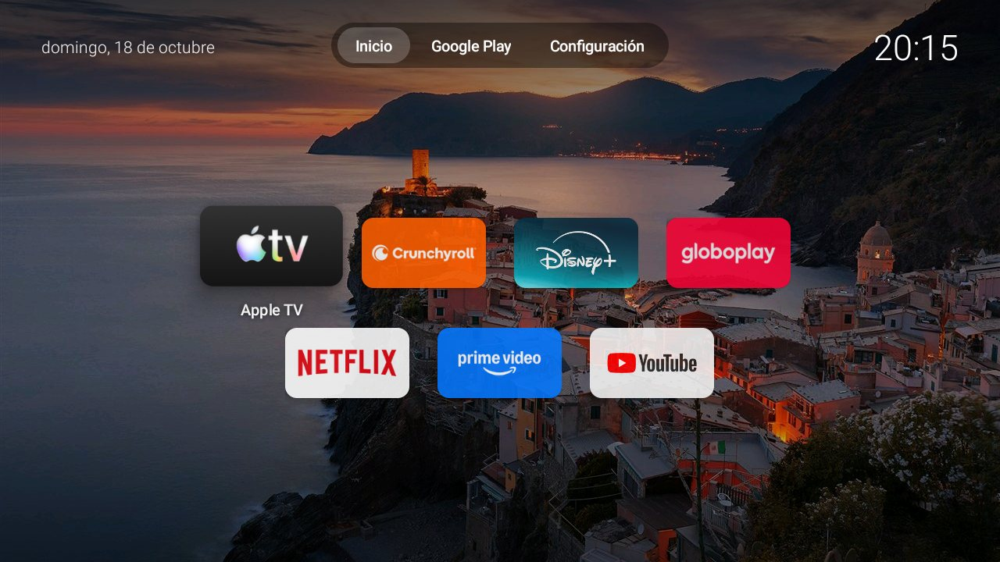

# androidtv-lite

[English](README.md) · **Português (Brasil)** · [Español](README.es.md)

Um launcher de Android TV **minimalista e leve**, escrito para TVs com pouca memória e processador fraco. É um único app de uma tela, em Java puro, sem Leanback, sem Compose e sem bibliotecas externas.

O visual é inspirado na tela inicial do Apple TV (tvOS). Este projeto **não é afiliado à Apple** nem a nenhuma das marcas dos apps exibidos.


<details>
<summary>Outros idiomas (capturas de tela)</summary>

| English | Español |
|---|---|
|  |  |

</details>

> A captura em português foi tirada em uma TV configurada em português. As de inglês e espanhol foram tiradas na mesma TV, com o idioma do app forçado por uma versão de depuração, e mostram o que uma TV nesses idiomas exibe.

## Sumário

- [O que ele faz](#o-que-ele-faz)
- [Idiomas](#idiomas)
- [Requisitos](#requisitos)
- [Compilar](#compilar)
- [Instalar na TV](#instalar-na-tv)
- [Tornar o launcher padrão](#tornar-o-launcher-padrão)
- [Voltar ao launcher original / desinstalar](#voltar-ao-launcher-original--desinstalar)
- [Personalizar](#personalizar)
- [Como ele escolhe os apps](#como-ele-escolhe-os-apps)
- [Limitações conhecidas](#limitações-conhecidas)
- [Solução de problemas](#solução-de-problemas)
- [Estrutura do projeto](#estrutura-do-projeto)
- [Licença](#licença)

## O que ele faz

- **Barra de navegação no topo, centralizada:** `Início` · `Google Play` · `Configurações`, em pílula translúcida. A aba com foco vira uma pílula branca, como no tvOS.
- **Data no canto superior esquerdo e horário no direito.**
- **Grade de apps centralizada**, em 4 colunas e várias linhas, sem rolagem lateral. O app em foco sobe, aumenta e mostra o nome embaixo.
- **Ordem alfabética**, ignorando acentos e maiúsculas.
- **Só apps de streaming conhecidos** e qualquer app instalado por você. Apps de sistema da fabricante e do Google ficam de fora.
- **Imagem de fundo** reduzida para 1280 px e carregada em RGB_565, para gastar pouca memória. É fácil trocar por outra.
- **Sem rede, sem anúncios, sem telemetria, sem permissões.** O app não pede nenhuma permissão.

## Idiomas

O launcher segue o **idioma do sistema da TV**. Não há nada para configurar.

| Idioma da TV | Barra de navegação | Exemplo de data |
|---|---|---|
| English (padrão) | Home · Google Play · Settings | Sunday, October 18 |
| Português | Início · Google Play · Configurações | domingo, 18 de outubro |
| Español | Inicio · Google Play · Configuración | domingo, 18 de octubre |

- Qualquer outro idioma cai em **inglês**.
- A data segue o formato do próprio idioma, e o relógio segue a configuração de **12 h / 24 h** da TV (o formato de 12 h não mostra AM/PM).
- Os nomes dos apps vêm de cada app, então aparecem no idioma que o app fornecer.

**Adicionar um idioma:** crie `res/values-xx/strings.xml` (`xx` = código do idioma, por exemplo `fr`) com as três strings abaixo e recompile. Pull requests são bem-vindos.

```xml
<resources>
    <string name="app_name">...</string>
    <string name="nav_home">...</string>
    <string name="nav_settings">...</string>
</resources>
```

## Requisitos

**Na TV**

- Android TV com **Android 8.0 (API 26) ou superior**.
- Depuração por ADB ativada (passos abaixo).

Testado em uma TV TCL com **Android 9**, **1,4 GB de RAM** e armazenamento eMMC lento. Não foi testado em outros aparelhos. Se funcionar (ou não) no seu, abra uma *issue*.

**No computador (para compilar)**

- **JDK 17** ou superior. Com JDK 22+ veja a [observação sobre o D8](#observação-sobre-jdk-novo-e-o-d8).
- **Android SDK** com `build-tools` e `platforms;android-28`.
- **ADB** (`platform-tools`) para instalar.

## Compilar

O projeto não usa Gradle. O script `build.ps1` (Windows/PowerShell) chama direto `aapt2`, `javac`, `d8`, `zipalign` e `apksigner`.

### 1. Obter o Android SDK mínimo

Se você ainda não tem o SDK, baixe as *command-line tools* em <https://developer.android.com/studio#command-line-tools-only> e rode:

```powershell
sdkmanager --sdk_root=C:\Android\sdk "build-tools;34.0.0" "platforms;android-28"
```

Você precisará aceitar as licenças do Android SDK.

### 2. Compilar

```powershell
git clone https://github.com/gustavommartins/androidtv-lite.git
cd androidtv-lite
.\build.ps1 -SdkRoot C:\Android\sdk
```

O APK sai em `build\androidtv-lite.apk`. Ele é assinado com uma chave de teste criada localmente em `build\debug.keystore`. Essa pasta não é versionada, e **a chave é mantida entre as compilações**, então você pode atualizar uma cópia já instalada com `adb install -r`.

> Se o PowerShell bloquear scripts, rode:
> `powershell -ExecutionPolicy Bypass -File .\build.ps1 -SdkRoot C:\Android\sdk`

### Observação sobre JDK novo e o D8

O D8 que vem nas `build-tools` 34 pode falhar com bytecode gerado por JDKs muito novos (por exemplo, o JDK 25), com um `NullPointerException` ao converter classes anônimas. Há duas saídas:

1. Usar o **JDK 17** para compilar; ou
2. Passar um R8/D8 mais novo, do repositório Maven do Google:

```powershell
Invoke-WebRequest "https://dl.google.com/dl/android/maven2/com/android/tools/r8/8.7.18/r8-8.7.18.jar" -OutFile r8.jar
.\build.ps1 -SdkRoot C:\Android\sdk -R8Jar .\r8.jar
```

### Em Linux ou macOS

O script é para Windows, mas os passos são os mesmos: `aapt2 compile` → `aapt2 link` → `javac --release 8` → `d8` → adicionar `classes.dex` ao APK → `zipalign` → `apksigner sign`. Leia o `build.ps1` como referência.

## Instalar na TV

### 1. Ativar o modo desenvolvedor na TV

1. **Configurações → Preferências do dispositivo → Sobre**.
2. Clique **7 vezes** em **Build** (ou "Versão do SO") até aparecer *"Você agora é um desenvolvedor"*.
3. Volte e abra **Preferências do dispositivo → Opções do desenvolvedor**.
4. Ative **Depuração USB** e, se existir, **Depuração por rede/Wi-Fi (ADB)**.

Em muitas TVs, ativar a Depuração USB já abre a porta ADB na rede (porta 5555), mesmo sem a opção separada de rede.

### 2. Descobrir o IP da TV

**Configurações → Rede e Internet →** conexão atual. Anote o endereço IP (algo como `192.168.0.50`).

### 3. Conectar e instalar

```powershell
adb connect 192.168.0.50:5555
adb devices
adb install -r build\androidtv-lite.apk
```

Na primeira conexão, a TV mostra o aviso **"Permitir depuração USB?"**. Marque **"Sempre permitir a partir deste computador"** e confirme. Se o `adb devices` mostrar `unauthorized`, aceite o aviso na TV e conecte de novo.

### 4. Abrir

O app aparece na lista de apps da TV como **Launcher Leve** (ou o nome traduzido). Você já pode abri-lo por lá, sem torná-lo padrão. Nada mais foi alterado na TV.

## Tornar o launcher padrão

```powershell
adb shell cmd package set-home-activity com.androidtvlite.launcher/.MainActivity
```

Isso registra o launcher como tela inicial preferida. A TV deve abrir nele ao ligar.

### Se o botão Home continuar abrindo o launcher original

Algumas fabricantes chamam o launcher original diretamente quando você aperta **Home**, ignorando a preferência. Foi o caso na TV TCL onde isto foi desenvolvido. Para forçar o Home a cair neste launcher, é preciso **desativar o launcher original** só para o seu usuário:

```powershell
adb shell pm disable-user --user 0 com.google.android.tvlauncher
```

Antes de fazer isso, saiba que:

- É um launcher do Google e outras partes do sistema podem tentar abri-lo.
- Se este launcher falhar com o original desativado, a TV mostra uma tela de recuperação da fabricante. Você ainda consegue reverter pelo computador (comandos abaixo).
- Atualizações do sistema ou da Play Store podem reativá-lo.
- O nome do pacote do launcher original pode ser diferente na sua TV. Confira com `adb shell cmd package query-activities --brief -a android.intent.action.MAIN -c android.intent.category.HOME`.

## Voltar ao launcher original / desinstalar

```powershell
# Reativar o launcher original (se você o desativou)
adb shell pm enable com.google.android.tvlauncher

# Voltar a preferência para o original
adb shell cmd package set-home-activity com.google.android.tvlauncher/.MainActivity

# Remover este launcher
adb shell pm uninstall com.androidtvlite.launcher
```

Se algo der muito errado, um **reset de fábrica** da TV restaura tudo.

## Personalizar

Tudo está em `src/com/androidtvlite/launcher/MainActivity.java`. Depois de editar, rode `build.ps1` e reinstale com `adb install -r`.

| O que mudar | Onde |
|---|---|
| Apps de streaming "conhecidos" | constante `PREFERRED` (lista de nomes de pacote) |
| Número de colunas da grade | constante `COLUMNS` |
| Tamanho dos cartões | `cardW` e `cardH` em `makeTile` |
| Tamanho do aumento no foco | `1.15f` em `makeTile` (e `1.04f` em `makeTab`) |
| Itens da barra de navegação | chamadas a `makeTab(...)` em `onCreate` |
| Textos (barra, nome do app) | `res/values*/strings.xml` |
| Escurecimento sobre o fundo | `GradientDrawable` do `scrim` em `onCreate` |
| Imagem de fundo | `res/drawable-nodpi/bg.jpg` |

### Trocar a imagem de fundo

Substitua `res/drawable-nodpi/bg.jpg` por uma imagem sua e recompile. Dicas:

- **1280 px de largura** é suficiente e usa pouca memória. Evite imagens 4K, que gastam RAM à toa.
- Formato JPEG, qualidade em torno de 85.
- O fundo é cortado para preencher a tela (`centerCrop`), então mantenha o assunto principal no centro.
- A foto que vem no repositório (uma vila costeira ao pôr do sol) é a imagem escolhida pelo autor do projeto. **Ela não está coberta pela licença MIT**: os direitos pertencem ao fotógrafo, e eu não sei a licença original. Se você for o dono e quiser que ela saia, ou se for redistribuir o projeto, troque o arquivo por uma imagem sua ou de licença livre.
- Se usar uma foto de terceiros, respeite a licença dela.

## Como ele escolhe os apps

1. Consulta o sistema por apps com a categoria `LEANBACK_LAUNCHER` (os apps feitos para TV).
2. Ignora o próprio launcher, a Play Store e as Configurações (que já estão na barra).
3. Mantém um app se ele estiver na lista `PREFERRED` **ou** se **não for app de sistema**, ou seja, qualquer app que você instalar.
4. Ordena por nome, ignorando acentos e maiúsculas.
5. A lista é refeita sempre que você volta à tela inicial, então um app recém-instalado aparece sem reiniciar.

## Limitações conhecidas

- **Apps só de celular** (sem versão para Android TV) não aparecem. É uma regra do Android; nenhum launcher de TV os mostra.
- **Sem pesquisa, sem recomendações, sem "continuar assistindo".** É de propósito: o objetivo é ser leve.
- **Sem widgets e sem canais da tela inicial** do Android TV.
- **Sem ícone de app próprio** na entrada do launcher.
- O comportamento do botão **Home** e da inicialização varia entre fabricantes. Veja a seção sobre o launcher padrão.
- Os tamanhos são em `dp`, mas o layout só foi conferido em uma TV que renderiza em 1280×720. Em outras telas, pode ser preciso ajustar `cardW`/`cardH` e as margens.

## Solução de problemas

| Sintoma | O que fazer |
|---|---|
| `adb connect` falha | Confira o IP, se a TV e o PC estão na mesma rede e se a depuração está ativa. Tente desligar e ligar a Depuração USB. |
| `adb devices` mostra `unauthorized` | Aceite o aviso "Permitir depuração" na tela da TV e conecte de novo. |
| `INSTALL_FAILED_UPDATE_INCOMPATIBLE` | A cópia instalada foi assinada com outra chave. Desinstale antes: `adb shell pm uninstall com.androidtvlite.launcher`. Daí em diante, guarde o `build\debug.keystore`. |
| O app não aparece na lista de apps | Confirme com `adb shell pm list packages com.androidtvlite.launcher`. |
| O Home abre o launcher original | Veja [Se o botão Home continuar abrindo o launcher original](#se-o-botão-home-continuar-abrindo-o-launcher-original). |
| Um app de streaming não aparece | Ele precisa ter a categoria `LEANBACK_LAUNCHER`. Confira com `adb shell cmd package query-activities --brief -a android.intent.action.MAIN -c android.intent.category.LEANBACK_LAUNCHER`. |
| `build.ps1` falha no D8 com `NullPointerException` | Use o JDK 17 ou passe `-R8Jar` (veja [Observação sobre JDK novo e o D8](#observação-sobre-jdk-novo-e-o-d8)). |
| O texto está no idioma errado | O launcher segue o idioma do sistema da TV. Troque nas configurações da TV; idiomas sem tradução mostram inglês. |
| Preciso do launcher antigo de volta agora | `adb shell pm enable com.google.android.tvlauncher` e depois o `set-home-activity` do original. |

## Estrutura do projeto

```
androidtv-lite/
├── AndroidManifest.xml                       # atividade HOME + LEANBACK_LAUNCHER, sem permissões
├── build.ps1                                 # compila e assina o APK (sem Gradle)
├── docs/screenshots/                         # imagens do README
├── res/
│   ├── drawable-nodpi/bg.jpg                 # fundo (foto, fora da licença MIT)
│   ├── values/strings.xml                    # inglês (padrão)
│   ├── values-pt/strings.xml                 # português
│   └── values-es/strings.xml                 # espanhol
└── src/com/androidtvlite/launcher/
    └── MainActivity.java                     # toda a interface e a lógica (~370 linhas)
```

Toda a interface é montada em código (sem XML de layout), o que mantém o app pequeno. O APK final tem cerca de 200 KB, quase tudo é a foto de fundo (o código em si ocupa poucas dezenas de KB).

## Licença

[MIT](LICENSE) para o **código**. Use, copie e modifique à vontade.

A licença MIT **não cobre** a imagem de fundo `res/drawable-nodpi/bg.jpg` (veja a seção sobre como trocá-la).

As marcas e logotipos dos apps exibidos (Netflix, YouTube, Prime Video, Globoplay, Disney+, Apple TV, Crunchyroll e outros) pertencem aos respectivos donos. Eles aparecem apenas porque cada app fornece o próprio banner ao sistema.
